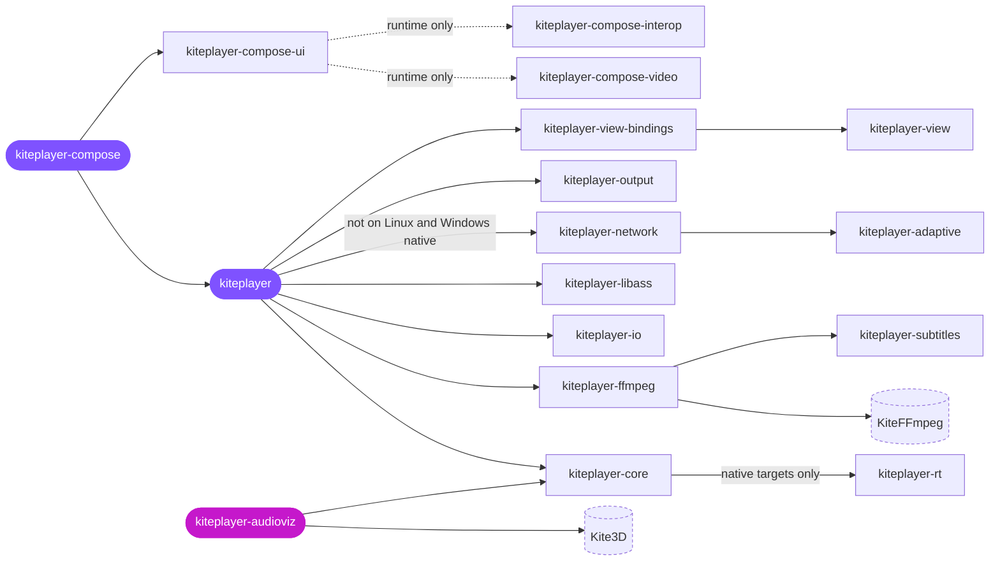

<a name="top"></a>
<p align="center">
  
</p>

<p align="center">
  A media playback library for Kotlin Multiplatform apps. Its engine is written in Kotlin and plays
  video, audio and subtitles on Android, iOS, macOS, the desktop JVM and the web, with FFmpeg already
  inside the artifacts through <a href="https://github.com/yuroyami/KiteFFmpeg">KiteFFmpeg</a>. It
  takes mpv and VLC as its models, and aims for their performance and range of features.
</p>

<p align="center">
  <sub>AI tools wrote much of the code, tests and documentation in this project, under the direction
  and review of its author.</sub>
</p>

<p align="center">
  <kbd>&nbsp;Android&nbsp;</kbd>&nbsp;
  <kbd>&nbsp;iOS&nbsp;</kbd>&nbsp;
  <kbd>&nbsp;macOS&nbsp;</kbd>&nbsp;
  <kbd>&nbsp;Desktop JVM&nbsp;</kbd>&nbsp;
  <kbd>&nbsp;Web&nbsp;</kbd>
</p>

<p align="center">
  <a href="https://central.sonatype.com/artifact/io.github.yuroyami/kiteplayer"></a>
  <a href="https://github.com/yuroyami/KitePlayer/actions/workflows/ci.yml"></a>
  <a href="https://kotlinlang.org"></a>
  <a href="https://www.jetbrains.com/compose-multiplatform/"></a>
  <a href="LICENSE"></a>
</p>

<p align="center">
  <a href="#install"><b>Install</b></a>&ensp;·&ensp;
  <a href="#play-something"><b>Play something</b></a>&ensp;·&ensp;
  <a href="#what-you-can-control"><b>Control</b></a>&ensp;·&ensp;
  <a href="#subtitles"><b>Subtitles</b></a>&ensp;·&ensp;
  <a href="#network"><b>Network</b></a>&ensp;·&ensp;
  <a href="#where-it-runs"><b>Platforms</b></a>&ensp;·&ensp;
  <a href="#modules"><b>Modules</b></a>
  <br>
  <sub><a href="docs/README.md">Guides</a>&ensp;·&ensp;<a href="https://yuroyami.github.io/KitePlayer/">API reference</a>&ensp;·&ensp;<a href="CHANGELOG.md">Changelog</a>&ensp;·&ensp;<a href="CONTRIBUTING.md">Contributing</a></sub>
</p>

## What it is

<table>
<tr>
<td width="50%" valign="top">

**A library, not an app.**<br>
You add KitePlayer to your app with one Gradle line. Your code gets a player object, and your
screen shows the video in a native view or a Compose composable. The sample apps in this repository
only show how to use the library.

</td>
<td width="50%" valign="top">

**Its own engine, not a wrapper.**<br>
KitePlayer does not put a common API over ExoPlayer, AVPlayer, mpv or VLC. The seeking, the audio
and video sync, the subtitle timing and the playback state are KitePlayer's own Kotlin code, so
every platform behaves the same way.

</td>
</tr>
<tr>
<td width="50%" valign="top">

**FFmpeg inside.**<br>
FFmpeg reads and decodes the media, through [KiteFFmpeg](https://github.com/yuroyami/KiteFFmpeg).
Its libraries come inside the artifacts that Gradle downloads.

</td>
<td width="50%" valign="top">

**Little from the platform.**<br>
Each platform supplies an audio output, a video surface and, where the device has one, a hardware
video decoder.

</td>
</tr>
</table>

## What you get

<table>
<tr>
<td width="50%" valign="top">

**Formats**

- Video: H.264, H.265 (HEVC) in 8 and 10 bit, AV1, VP9, MPEG-2, MPEG-4 Part 2 and the rest of
  what FFmpeg decodes.
- Audio: AAC, MP3, Opus, Vorbis, FLAC, ALAC, AC-3, E-AC-3, DTS, TrueHD and PCM.
- Containers: MKV, WebM, MP4, MOV, MPEG-TS, AVI, FLV, VOB, WMV, WAV and raw streams.
- A transport stream with several channels, such as a DVB recording or an IPTV multiplex, plays one
  channel's tracks together. `Tracks.programs` lists the channels, `DemuxPolicy.program` picks one
  before the open and `KitePlayer.selectProgram` switches while playing.
- Hardware decoding through MediaCodec on Android (H.264 and HEVC) and through VideoToolbox on Apple
  and on the desktop JVM on a Mac (H.264, HEVC and AV1), with software decoding when the device
  cannot. AV1 decodes with dav1d where the device has no AV1 hardware.
- The web build carries a smaller set: H.264, HEVC, VP9, AAC, MP3, Opus, Vorbis, FLAC and PCM, in
  MP4, MOV, MKV, WebM, MP3 and FLAC files.

</td>
<td width="50%" valign="top">

**Picture**

- True HDR: HDR10 and HLG show as HDR on a display that can show it, through Metal on a Mac or an
  iPhone and through `KitePlayerView` on an Android HDR display. Elsewhere they are tone mapped.
- Dolby Vision: KitePlayer composes profile 5 and 10.0 into HDR10 on the processor, and each
  scene's own brightness guides the tone mapping.
- Picture-in-picture on Android, iOS, macOS and in the browser, and a floating window on the
  desktop JVM.
- Rotation and mirroring from the file, on every renderer, and the viewer's own quarter turns and
  mirrors on top.
- Fit, fill and stretch, zoom, pan and a forced aspect ratio. Brightness, contrast, saturation and
  hue.
- Dithering, debanding, a sharper scaler and an upscaler for animation, on Apple's Metal renderer
  and Android's GPU renderer.
- Dimming of flashing video, which follows Apple's Dim Flashing Lights setting by default.
- A native view on Android, iOS and the desktop JVM, or Compose with two paths: the platform's
  video view, or video drawn by Compose that takes clipping, alpha and shared element transitions.
- Frame stepping, screenshots to PNG or JPEG, and thumbnails.

</td>
</tr>
<tr>
<td width="50%" valign="top">

**Sound**

- Speed from 0.25x to 4x with the pitch kept. A speed change while it plays makes no pause and no
  gap.
- A ten band equalizer with a preamp, balance, ReplayGain, volume up to twice the normal level
  with soft clipping instead of hard clipping, audio delay, and a sleep timer that fades out.
- A stereo mode: mono, left only, right only or swapped, after the downmix, with no click on a
  change.
- Surround folds into the speakers the device has, and mono or stereo can fill a surround device.
  Apple outputs take up to 7.1, and an iPhone tells the system when an item is surround, so a
  receiver or headphones that place sound in space can take it.
- A choice of output device on macOS and the desktop JVM.
- Audio files and streams beside the video, such as a dub or a commentary, as tracks of the item.
- Waveforms, and an optional audio visualizer for media with no picture.

</td>
<td width="50%" valign="top">

**Subtitles**

- ASS and SSA drawn by libass as authored: signs, karaoke, animated transforms and the fonts the
  file carries.
- SubRip and WebVTT, DVB teletext, and Blu-ray (PGS), DVD, DVB and XSUB image subtitles.
- Synced lyrics, and the closed captions that broadcast video carries.
- External subtitle files that load during playback, and a second subtitle track at the same time.
- Delay, scale, position, style and a safe area that keeps text out of cutouts and controls.

</td>
</tr>
<tr>
<td width="50%" valign="top">

**Streaming and input**

- HTTP and HTTPS with your headers, through OkHttp on Android and the JVM and NSURLSession on
  Apple.
- HLS: master playlists, a choice of variant, automatic steps down and up with the network rate,
  MPEG-TS and fMP4 segments, AES-128, separate audio and subtitle renditions, IMSC (TTML) subtitle
  renditions, backup variants for a server that fails, and live playlists. A DASH manifest's backup
  `BaseURL`s work the same way.
- DASH for fMP4, MPEG-TS and WebM segments: separate video, audio and subtitle sets, seeking, a
  variant for each video representation, segment indexes of single files, live manifests, and
  manifests of several Periods joined into one presentation. TTML and MP4 subtitle sets play as
  WebVTT. A DASH or HLS address plays as it is, recognized by its content type, its extension or
  its first bytes.
- A segment store that keeps HLS and DASH segments on disk for the next session.
- Lists of streams, as radio stations hand them out: a PLS file, or an M3U list that is not HLS.
- Files, memory, bytes that your code pushes, streams, and Android content URIs and assets.
- Recording of what plays into a Matroska file, with no re-encode.

</td>
<td width="50%" valign="top">

**Playback**

- A gapless queue or a crossfade, shuffle, loops, chapters, an A-B loop and position markers.
- Precise seeks, or the nearest keyframe at once and the exact frame a moment later for fast
  scrubbing.
- Resume: one call saves the item, the position, the tracks and the speed.
- An external clock that playback follows, for watching together.
- Typed errors and warnings, a diagnostics dump, and a trace that Perfetto opens.

</td>
</tr>
<tr>
<td colspan="2" valign="top">

**On the device**

- A media notification and lock screen controls on Android and iOS, Now Playing and the media keys
  on a Mac, and playback in the background.
- Screen reader labels on the views and both Compose paths.

</td>
</tr>
</table>

Not every platform has every feature. [Where it runs](#where-it-runs) and
[the limitations](#limits) say what is missing where.

This desktop JVM program plays a song, seeks, and closes the player:

```kotlin
import io.github.yuroyami.kiteplayer.KitePlayer
import io.github.yuroyami.kiteplayer.MediaItem
import kotlinx.coroutines.delay
import kotlinx.coroutines.runBlocking
import kotlin.time.Duration.Companion.seconds

fun main() = runBlocking {
    val player = KitePlayer()

    // Returns when the item is open and paused
    player.open(MediaItem("/path/to/song.mp3"))
    player.play()
    delay(10.seconds)

    // Returns when the seek has landed
    player.seek(60.seconds)
    delay(10.seconds)

    player.closeAndAwait()
}
```

> [!NOTE]
> KitePlayer has not reached 1.0. It plays real media on Android, iOS, macOS and the desktop JVM,
> and it runs inside a shipping app, but the API can still change between versions. Read
> [the limitations](#limits) before you plan around it.

## Install

Pick one of the first two lines. Both pull in the whole playback stack, and Gradle picks the
platform pieces for each target you declare.

```kotlin
commonMain.dependencies {
    // Native views, no Compose
    implementation("io.github.yuroyami:kiteplayer:0.3.0")

    // Or Compose, with everything that the line above has
    implementation("io.github.yuroyami:kiteplayer-compose:0.3.0")

    // Optional: a visualizer for media with no picture
    implementation("io.github.yuroyami:kiteplayer-audioviz:0.3.0")
}
```

You do not install FFmpeg, and there is no Gradle plugin. On Android, every artifact needs
`minSdk` 26 or higher. In an Android-only app, put the line in your usual `dependencies { }` block.
[Modules](#modules) draws what each line pulls in.

### What else you need

> [!IMPORTANT]
> Some setups need one more step. Without it, the link, the App Store upload, the first call or
> background playback fails.

| If you build | You also need |
| --- | --- |
| An iOS app with a **static** framework (`isStatic = true`) | **Linker flags** in Xcode. See [iOS setup](#ios-setup). |
| Any iOS app | **Two privacy manifest entries**, for boot time and file timestamp APIs. See [iOS setup](#ios-setup). |
| A web app (`wasmJs`) | **Two WebAssembly modules** that the page serves, for FFmpeg and libass, and a third for the worker player. See [Web setup](#web-setup). |
| Playback that goes on in the background on Android | **A service and three permissions** in your manifest. See [Background playback](#background-playback). |

<a name="ios-setup"></a>
<details name="setup">
<summary><b>iOS setup</b>: the linker flags and the privacy manifest entries</summary>
<br>

A dynamic framework needs no flags, because Kotlin links it with the system frameworks. Xcode links
a static framework instead, so add this to Other Linker Flags:

```text
-ObjC -lz -framework CoreFoundation -framework CoreMedia -framework CoreVideo -framework VideoToolbox -framework AudioToolbox
```

KitePlayer times playback with `mach_absolute_time`, which Apple lists as a system boot time API.
It also reads file sizes and dates with `stat`, `fstat` and `lstat`, from FFmpeg's file reader, the
libass chain and its own file readers, which Apple lists as file timestamp APIs. App Store Connect
refuses the upload (ITMS-91053) until both are declared in `PrivacyInfo.xcprivacy`. Keep only the
reasons that apply to your app: `35F9.1` is time measured between events inside the app, `C617.1`
is files inside the app container, and `3B52.1` is files that the user picked.

```xml
<key>NSPrivacyAccessedAPITypes</key>
<array>
    <dict>
        <key>NSPrivacyAccessedAPIType</key>
        <string>NSPrivacyAccessedAPICategorySystemBootTime</string>
        <key>NSPrivacyAccessedAPITypeReasons</key>
        <array><string>35F9.1</string></array>
    </dict>
    <dict>
        <key>NSPrivacyAccessedAPIType</key>
        <string>NSPrivacyAccessedAPICategoryFileTimestamp</string>
        <key>NSPrivacyAccessedAPITypeReasons</key>
        <array><string>C617.1</string><string>3B52.1</string></array>
    </dict>
</array>
```

</details>

<a name="web-setup"></a>
<details name="setup">
<summary><b>Web setup</b>: the modules a page serves</summary>
<br>

A browser cannot link FFmpeg or libass into the Kotlin binary, so the page serves them as two
WebAssembly modules. Each one comes as a `web` zip beside its artifact on Maven Central:

1. Unpack `kiteffmpeg-wasm-js-<version>-web.zip` beside `index.html`. Use the KiteFFmpeg version
   that KitePlayer depends on (0.5.1 for KitePlayer 0.3.0). The page then serves `kite.mjs`,
   `kite.wasm` and `licenses/`.
2. Unpack `kiteplayer-libass-wasm-js-<version>-web.zip` there too, for `kiteass.mjs` and
   `kiteass.wasm`. The first ASS track loads them. Without them, KitePlayer draws ASS with the
   built-in styling.
3. Call `KiteFFmpegWeb.load()` before you create a player. It fetches `./kite.mjs`. Under a
   bundler, instantiate the module from a plain `<script type="module">` and pass it to
   `KiteFFmpegWeb.attach()` instead.

Serve `.mjs` as `text/javascript` and `.wasm` as `application/wasm`. With gzip, the codec module is
about 1.5 MiB to download. Both modules are single-threaded, so the page needs no cross-origin
isolation headers (`Cross-Origin-Opener-Policy` and `Cross-Origin-Embedder-Policy`). A browser
starts audio only after the user interacts with the page, so the position stays at zero until then.

`KitePlayerWorker.start(canvas)` runs the player in a web worker, so opening, decoding and drawing
leave the page's thread free. The worker draws on the canvas and sends its sound straight to the
page's audio device. It plays `http`, `https` and `blob` addresses, which a player on the page's
own thread cannot (see [Network](#network)). It loads a third module: unpack
`kiteplayer-wasm-js-<version>-web.zip` beside `index.html` too, for `kiteplayer-web-worker.mjs`
and the files beside it. With gzip, the worker is about 0.7 MiB to download.

- The worker player has the calls and flows of `KitePlayer` with the same names, except those that
  its KDoc lists, such as `captureFrame` and recording.
- A setter that the worker refuses does not throw at the call. The refusal arrives on `events` as
  `PlaybackWarning.CommandRefused`.
- An item, an external subtitle or an external audio input with a reader of its own cannot cross
  to the worker. Give it an address instead.
- The worker loads `kiteass.mjs` from beside the page too, so the libass zip from step 2 serves
  both players. Pass `workerUrl`, `codecUrl` or `libassUrl` to `KitePlayerWorker.start` when the
  files are somewhere else.
- `pictureInPictureOrNull()` puts the worker's canvas in a picture-in-picture window, as
  `KitePlayerPictureInPicture` does for the page's own player.

</details>

## Play something

Three steps: create a player, show it, open something. The order of the last two does not
matter: media may open before the view is on screen.

### ❶ Create a player

```kotlin
import io.github.yuroyami.kiteplayer.KitePlayer

val player = KitePlayer()
```

`KitePlayer()` builds the player on this platform's default stack: FFmpeg, and the platform's own
audio output. Where the platform cannot play, it throws a `PlaybackException` that says why;
`KitePlayer.isAvailable` checks that first. Settings go in a block, for example
`KitePlayer { subtitles { preferredLanguages = listOf("ja") } }`.

### ❷ Show it

<details name="show" open>
<summary><b>In Compose</b>: <code>KitePlayerVideo</code></summary>
<br>

In Compose, `rememberKitePlayer()` builds the player and closes it when the composable leaves.
`KitePlayerVideo` shows it:

```kotlin
import androidx.compose.foundation.layout.fillMaxSize
import androidx.compose.runtime.Composable
import androidx.compose.runtime.LaunchedEffect
import androidx.compose.ui.Modifier
import io.github.yuroyami.kiteplayer.MediaItem
import io.github.yuroyami.kiteplayer.compose.KitePlayerVideo
import io.github.yuroyami.kiteplayer.compose.rememberKitePlayer

@Composable
fun MovieScreen() {
    val player = rememberKitePlayer()
    KitePlayerVideo(player, Modifier.fillMaxSize())

    LaunchedEffect(player) {
        player.open(MediaItem("https://example.com/movie.mkv"))
        player.play()
    }
}
```

> [!TIP]
> On Android, a screen rotation recreates the activity, so the composable leaves and
> `rememberKitePlayer()` closes the player. To play on through a rotation, hold the player in a
> `ViewModel` and close it in `onCleared`.

> [!TIP]
> `KitePlayerVideo` draws in one of two ways. `KiteRenderPath.NativeView` hosts the platform's
> video view: the system compositor shows the frames and the GPU stays idle, which suits long
> playback, so it is the default. `KiteRenderPath.ComposeCanvas` draws the frames inside Compose,
> so the video takes clipping, alpha and shared element transitions. You can switch while it plays.

The video has no controls until you ask for them. `KitePlayerControls` draws a default set over
it: play and pause, previous and next for a queue, the seek bar, the volume, and menus for the
audio and subtitle tracks, the quality and the speed. A tap on the picture shows or hides them.

> [!WARNING]
> On the desktop JVM, the native view takes every click. Controls that you draw over the native
> view do not receive clicks. Pass `path = KiteRenderPath.ComposeCanvas` to `KitePlayerVideo`, or
> put the controls beside the video.

```kotlin
@Composable
fun MovieWithControls(player: KitePlayer) {
    KitePlayerVideo(player, Modifier.fillMaxSize()) {
        KitePlayerControls(player)
    }
}
```

Its words come from `KitePlayerControlsLabels`, in English unless you pass your own, and its look
from `KitePlayerControlsStyle`. For controls of your own, build them from the same state holders:
`rememberTransportState`, `rememberSeekBarState`, `rememberTrackMenuState`,
`rememberQualityMenuState`, `rememberSpeedMenuState`, `rememberVolumeState` and
`rememberControlsVisibility`.

</details>

<details name="show">
<summary><b>In a native view</b>: <code>KitePlayerView</code>, <code>KitePlayerUIView</code>, <code>KitePlayerAwtView</code></summary>
<br>

For a native view, give the view the player. The views are in `io.github.yuroyami.kiteplayer.view`:
`KitePlayerView` on Android, from XML or code, `KitePlayerUIView` on iOS, and `KitePlayerAwtView` on
the desktop JVM.

```kotlin
view.player = player
```

A view has no controls until you ask for them. Each of the three views draws a default set from
its own toolkit, with no Compose:

```kotlin
view.showsControls = true

// Your window, your rule
view.onFullScreen = { }
```

They have play and pause, previous and next, a seek bar with the buffered ranges, mute, and menus
for the audio tracks, the subtitles, the quality and the speed. Their words come from
`view.controlsStrings`, in English unless you pass your own `PlayerControlsStrings`. For controls of
your own in a native toolkit, read `PlayerControlsModel`: it holds the state and the commands, and
no toolkit.

A player from `KitePlayer()` gives the views their renderer. A player built with `KitePlayer.create`
on backends of your own also needs `view.installMobileRenderer()`, or `installDesktopRenderer()` on
the desktop, from `io.github.yuroyami.kiteplayer.mobile`.

While a video plays on screen, the display stays awake: every view, `KitePlayerVideo`, the Mac's
`AppKitVideoRenderer` and the web's canvas renderers hold it, and let it sleep at a pause, the end,
or with sound only. Pass `keepDisplayAwake = false` to turn that off. The desktop JVM has no way to
hold its display, so there it does nothing.

</details>

### ❸ Open something

Then open media from a coroutine that you own. A call that takes time suspends until it is done:
`open`, `seek` and `closeAndAwait`. `play`, `pause` and the setters return at once.
`requestSeek` is the seek that does not wait, for a seek bar being dragged.

```kotlin
import io.github.yuroyami.kiteplayer.MediaItem
import kotlin.time.Duration.Companion.seconds

player.open(MediaItem("https://example.com/movie.mkv"))
player.play()
player.seek(90.seconds)

// When the screen goes away, unless rememberKitePlayer owns the player:
player.closeAndAwait()
```

<details>
<summary><b>From Java</b>: listeners, futures and milliseconds</summary>
<br>

The player speaks in coroutines and flows, which Java cannot call. On Android and the desktop JVM,
`KitePlayerJava` adds what Java lacks: listeners called on an executor you name, a
`CompletableFuture` version of every call that suspends, and milliseconds wherever the Kotlin call
takes a `Duration`. `MediaItemBuilder` makes the item, and `PlayerConfigBuilder` the settings.

```java
KitePlayerJava player = KitePlayerJava.create();
player.addListener(new KitePlayerListener() {
    @Override
    public void onState(PlayerSnapshot state) {
        statusView.setText(state.getStatus().name());
    }

    @Override
    public void onProgress(Progress progress) {
        seekBar.setProgress((int) progress.getPositionMillis());
    }
}, ContextCompat.getMainExecutor(context));

player.openAsync(new MediaItemBuilder("https://example.com/movie.mkv").build())
        .thenRun(() -> player.getPlayer().play());
player.seekAsync(90_000);

// When the screen goes away:
player.close();
```

Canceling a future cancels its call, as canceling the coroutine does in Kotlin. Every other call,
such as `play()`, `pause()` and `setVolume(float)`, is on `getPlayer()`.

> [!NOTE]
> A listener hears each event that happens after it is added, and none from before: the player
> replays no event.

</details>

## Media that is not a URL

A file path or a URL needs nothing more. `MediaItem("/sdcard/movie.mkv")` goes straight to
FFmpeg's own file reader, which is the fastest way to read a local file. So does the address a
Compose Multiplatform resource has, on Android, iOS and the desktop JVM:
`MediaItem(Res.getUri("files/intro.mp4"))` plays the bundled file, from the app's assets on
Android and from the app's jar on the desktop. On Android that reads the assets through the
application context, which a small content provider of `kiteplayer-io` keeps from the moment the
app starts, as Compose's own resources do.

For anything else, use a **door**: a function that turns what you have into a `MediaIoFactory`
for the item's `io` field. Each open of the item gets a new reader from it, because a track switch,
a loop or a recovery opens the item again.

| You have | Door | Where |
| --- | --- | --- |
| A `ByteArray` | `MediaIo.ofBytes(bytes)` | <kbd>Everywhere</kbd> |
| Bytes that your code pushes, from a socket or a decryptor | `PipedMediaIo`, a new one in each open | <kbd>Everywhere</kbd> |
| A `File` or a `Path` | `MediaIo.ofFile(file)`, `MediaIo.ofPath(path)` | <kbd>JVM</kbd> <kbd>Android</kbd> |
| A `FileChannel` that you keep open | `MediaIo.ofChannel(channel)` | <kbd>JVM</kbd> <kbd>Android</kbd> |
| An `InputStream` | `MediaIo.ofStream { openStream() }` | <kbd>JVM</kbd> <kbd>Android</kbd> |
| A `content://` URI, such as one from the file picker | `MediaIo.ofUri(contentResolver, uri)` | <kbd>Android</kbd> |
| A file in the app's `assets` | `MediaIo.ofAsset(assets, "clip.mp4")` | <kbd>Android</kbd> |
| A Compose Multiplatform resource's `Res.getUri` address, when you set a resolver of your own | `MediaIo.ofResourceUri(context, uri)`, `MediaIo.ofResourceUri(uri)` | <kbd>Android</kbd> <kbd>JVM</kbd> |
| A path that every read must pass through Kotlin | `MediaIo.ofPath("/path/to/clip.mp4")` | <kbd>Apple</kbd> <kbd>Linux</kbd> |
| A file URL, such as one from the document picker | `MediaIo.ofUrl(url)` | <kbd>Apple</kbd> |

```kotlin
import io.github.yuroyami.kiteplayer.MediaIo
import io.github.yuroyami.kiteplayer.MediaItem
import io.github.yuroyami.kiteplayer.from
import io.github.yuroyami.kiteplayer.io.ofUri

val io = MediaIo.ofUri(contentResolver, uri)
player.open(MediaItem.from(io, label = "picked.mkv"))
player.play()
```

The label names the item in logs and helps FFmpeg guess the format. A stream and a pipe read
forward only, so the player cannot seek in them. `MediaIo.ofBytes` does not copy the array, so keep
it unchanged while playback can read it. The first two doors are in `kiteplayer-core`, and the
others in `kiteplayer-io`, which comes with `kiteplayer`. Each `MediaIo.of...` door is an
extension function that needs its own import: `ofBytes` from `io.github.yuroyami.kiteplayer`, and
the others from `io.github.yuroyami.kiteplayer.io`.

A file that is still being written, such as a recording in progress or a download that plays as it
arrives, plays to its current end and on as it grows when the item says so:
`MediaItem(path, growth = FileGrowth())`. The player waits at the end for more, and ends the item
once the file has not grown for `FileGrowth.endsAfter`, two seconds by default. Its length grows
with the file, and a seek reaches any part already written. A plain path needs `kiteplayer-io` for
this; an item with its own `io` needs nothing more.

<details>
<summary><b>Several settings on one item</b>: headers, probing and low latency</summary>
<br>

Build the item in a block. An empty block gives the same item as `MediaItem(uri)`.

```kotlin
import io.github.yuroyami.kiteplayer.CorruptPackets
import io.github.yuroyami.kiteplayer.ProbeDepth
import io.github.yuroyami.kiteplayer.mediaItem

val item = mediaItem("https://cdn.example.com/live/channel.ts") {
    header("Authorization", "Bearer $token")
    probe(ProbeDepth.Fast)
    corruptPackets(CorruptPackets.Drop)
    lowLatency()
}
```

`probe`, `corruptPackets`, `lowLatency` and the other demux settings say how the container opens,
and they fill the item's `demux` field. Raw FFmpeg options still go in `openOptions`, but an option
that a typed field also sets refuses the open with a typed error. `MediaItem` also carries
`startPosition`, `externalSubtitles`, `externalAudio`, `videoFilter` for an FFmpeg filter chain,
and `formatHint` when a container needs naming.

An item can play audio files or streams beside its media. Each one is an external audio input.

```kotlin
import io.github.yuroyami.kiteplayer.AudioSource

val french = AudioSource(
    "https://cdn.example.com/film.fr.m4a",
    title = "French",
    language = "fr",
)
val item = mediaItem("https://cdn.example.com/film.mp4") {
    externalAudio(french)
}
```

- The player lists the audio tracks of each input in `tracks.audio`, after the media's own tracks.
- `selectTrack(TrackKind.Audio, id)` plays one. The player reads only the input that you hear.
- At open, the player still chooses the media's own sound first. When the media has no sound, the
  player chooses the first input.
- A seek moves the media and the input together. An input that is shorter than the media goes
  silent at its end.
- When an input does not open, the player leaves it out and sends the warning
  `AudioSourceUnreadable`. The item still plays.

</details>

## What you can control

Everything here works during playback, and everything is published on `player.state`, so your UI
can read it back.

| Area | What to call |
| --- | --- |
| **Playback** | `open`, `play`, `pause`, `stop`, `seek`, `requestSeek`, `stepFrame`, `close`, `closeAndAwait` |
| **Queue** | `openQueue`, `next`, `previous` and `setLoop`. `addToQueue`, `removeFromQueue`, `moveInQueue` and `clearQueue` work while the queue plays. Items follow each other on the same audio device with no gap. `QueueConfig.gapless = false` turns that off, and [the gapless design](docs/gapless-queue.md) says when an item opens from scratch instead. `QueueConfig.crossfade` fades one song into the next. `QueueConfig.onItemFailure` makes the queue skip an item that does not open, instead of stopping on it |
| **Playlists** | `openPlaylist` opens an M3U, PLS or XSPF file as the queue. It also opens an album's cue sheet as the album's tracks, which play from one open of the file with no sample lost or repeated. `readPlaylist` gives you the items first, so you can filter or reorder them |
| **Shuffle** | `setShuffle`. The items stay in their places, and `PlayerSnapshot.queueOrder` tells you what plays next. `QueueConfig.reshuffleEachLap` draws a new order on each lap under `LoopMode.All` |
| **Speed** | `setSpeed`, from 0.25x to 4x with the pitch kept. `setPreservePitch(false)` lets the pitch change with the speed, as on a tape. `setPitch` moves the pitch by up to 12 semitones, and the speed stays the same |
| **Sync** | `setExternalClock` makes playback follow a clock that your app owns, for watching together. The player closes a small difference with a speed change of at most 0.5 percent, with the pitch kept. `PlayerConfig.externalClock` sets that limit. The player closes a large difference with one seek. Play and pause stay with your commands |
| **Sound** | `setVolume`, `setMuted`, `setBalance`, `setStereoMode` (mono, one side only, or swapped), `setNightMode` (quiet speech up, loud effects down), `setDialogueLevel` (the center of a downmix up or down), `setSkipSilence` (every pause longer than a fifth of a second cut down to that, on media with no picture), `setEqualizer` (ten bands and a preamp), `setAudioDelay`, `setSleepTimer` (with a fade), `setVideoEnabled(false)` for audio only |
| **Loudness** | `PlayerConfig.audio.volumeCeiling` lets the volume go up to 2.0. Above 1.0, the player softens loud peaks instead of clipping them. `PlayerConfig.audio.replayGain` applies the file's own ReplayGain tags. ReplayGain is off by default |
| **Surround** | Multichannel audio folds into the speakers the device has. `PlayerConfig.audio.upmix = UpmixMode.Surround` also plays mono and stereo from the other speakers of a surround device. Upmix is off by default |
| **Tracks** | `selectTrack` picks an audio, video or subtitle track. `selectVariant` picks an HLS or DASH variant, and `selectProgram` picks a channel of a transport stream |
| **Picture** | `setVideoScale` (fit, fill, stretch), `setVideoAdjustments` (brightness, contrast, saturation, hue), `setVideoTransform` (forced aspect, zoom, pan, quarter turns, mirrors), `setRenderQuality` (dithering, debanding, the scaler and the animation upscaler), `setFlashGuard` (dims flashing video, see [the flash guard](docs/video-flash-guard.md)) |
| **HDR** | `setHdrPolicy`. `HdrPolicy.ToneMap` tone maps everywhere. `PlaybackWarning.HdrToneMapped` tells you when the player tone maps, and `PlayerSnapshot.videoDynamicRange` tells you what the screen shows. `TrackInfo.dolbyVision` names the profile of a Dolby Vision track |
| **Subtitles** | `selectSecondarySubtitle`, `addExternalSubtitle`, `seekToSubtitleLine` (the line showing, the previous or the next), `stepSubtitleDelay` (a line forward or back), `setSubtitleScale`, `setSubtitleDelay`, `setSubtitlePosition`, `setSubtitleStyle`, `setSubtitleSafeArea`, `setForcedPicturesOnly`, and `subtitleCues` to draw the lines yourself. `PlayerConfig.subtitles.secondaryLanguages` shows a second track in another language at each open. That track shows at the top, or directly above or below the first with `secondaryPlacement` |
| **Sections** | `setAbLoop` repeats between two points. `setMarkers` fires an event when playback crosses a position |
| **Chapters** | `chapterAt`, `seekToChapter`, `nextChapter`, `previousChapter` |
| **Resume** | `memento()` saves the item, position, tracks and speed. `restore(memento)` puts them back |
| **Screenshots** | `captureFrame`. `kiteplayer-ffmpeg` encodes the frame to PNG or JPEG, and makes thumbnails and waveforms |
| **Recording** | `startRecording` copies what the player reads into a Matroska file, with no re-encode. `stopRecording` finishes the file. A seek ends a recording. The web build cannot record |
| **Picture-in-picture** | `KitePlayerPictureInPicture.createOrNull` on iOS, macOS, the desktop JVM and the web, then `start` and `stop`. On the desktop JVM it opens a floating window. On Android, call `KitePlayerView.enterPictureInPicture(activity)` |
| **Rendering** | `attachRenderer`, `detachRenderer`, swappable while media plays. `attachRendererAndAwait` refuses a renderer that cannot show the running decoder's frames, and keeps the renderer that was there before |
| **Diagnosis** | `diagnosticsDump`, `warningHistory`, `supportBundle`, and `KiteLog` as the one logging seam, silent by default. `KiteTrace` records a timeline that Chrome's trace viewer and Perfetto open, also silent by default |

Flows tell your UI what is happening: `state`, `progress`, `stats`, `events`, `subtitleCues` and
`coverArt`. `events` can drop an event when one collector falls 64 events behind, so collect
`losslessEvents` when you must see every event. `position()` reads the current time without
collecting anything. Anything the player cannot do is refused with a typed error, never accepted
and ignored, and two players in one process work.

> [!TIP]
> `SeekMode.Precise` is the default seek. `SeekMode.KeyframeThenRefine` shows the nearest keyframe
> at once and replaces it with the exact frame a moment later, which makes scrubbing feel instant
> on large files.

<details>
<summary><b>Audio devices and screen readers</b></summary>
<br>

On the desktop JVM and on macOS, you choose the audio output device when you build the player.
`audioOutputDevices()` on `DesktopOutputBackend` or `AppleOutputBackend` lists the devices, and
`withAudioOutputDevice(id)` returns the backend bound to one, for `PlayerConfig.backends`. A bound
player never moves to another device: when its device is gone, the open fails with
`PlaybackError.AudioDeviceUnavailable`, and so does playback when the device disappears.
On Android and iOS the operating system owns the route.

The Android, iOS and desktop views, and both paths of `KitePlayerVideo`, tell a screen reader that
they are the video and what the player is doing, for example "Playing, 1:23 of 4:56".
`accessibilityVideoLabel` and `accessibilityStateFormat` take translated words. `KiteVideo`, the
bare canvas, gets its semantics from the modifier you pass. On the web, the page owns the canvas
and labels it.

</details>

## Subtitles

- SubRip, WebVTT and SubStation Alpha, from the container or from an external file. External files
  load in the middle of playback.
- Synced lyrics: an `.lrc` file, or LRC lines in a song's own tags (an ID3 `USLT` frame, a Vorbis
  or Matroska `LYRICS`, an MP4 `©lyr`), become a track that shows line by line through
  `subtitleCues`. The player selects that track when no other track is selected. Lyrics without
  times are `PlayerSnapshot.lyrics`, for the application to show.
- `SubtitleConfig.hearingImpairedNotes` hides the notes of subtitles made for deaf and
  hard-of-hearing viewers: `[DOOR SLAMS]`, a `(laughs)` that opens a line, `JOHN:` and `♪` music
  lines, and with `HideStrict` every parenthesis. The setting does not change ASS scripts.
- An external file that you add without a language takes one from its name, as `Film.en.srt`,
  `Film.eng.forced.srt` and `Film.pt-BR.sdh.srt` say it. A `forced`, `sdh`, `cc` or `hi` in the
  name marks the track. At open, the player prefers a file in a preferred language over a container
  track in a later one.
- A subtitle the player chose by itself follows the audio: switching an anime to the English dub
  shows the English signs track made for it, and switching back shows every line again. One the
  viewer chose stays. `SubtitleConfig.withMatchingAudio`, as mpv's `subs-with-matching-audio`,
  keeps only forced tracks, or none, under audio in a preferred subtitle language.
- WebVTT keeps its colors: the standard's color classes such as `<c.yellow>` and `<c.bg_blue>`,
  and the `::cue` rules of its `STYLE` blocks for color, background, bold, italic, underline,
  font and relative size, by class, voice and cue identifier. The player ignores a whole rule that
  asks for anything more. A `SubtitleStyleOverride` still wins over the file's colors.
- Blu-ray (PGS), DVB, DVD and XSUB image subtitles from the container, placed on the picture they
  were authored for.
- DVB teletext subtitles from a broadcast recording or an IPTV stream, read in Kotlin with no
  native library. Each subtitle page the channel lists is a track of its own, with its language
  and its hearing impaired mark, as VLC lists them, and a page shows its colors, its boxed
  backgrounds and its double height lines in the top or bottom half of the picture. The letters
  follow the page's national character set, Latin, Cyrillic, Greek or Hebrew, as libzvbi reads
  them.
- The closed captions that broadcast H.264, HEVC and MPEG-2 carry inside the picture, which have
  no subtitle stream of their own, become a track, CC1, from the first picture that carries any.
  Each screen shows as it is sent, as mpv shows them, and like a television the player shows them
  when the viewer's preferences or the viewer ask, not by default. A platform decoder that draws
  straight to a surface gives no captions.
- A disc's forced captions, the signs and foreign dialogue it marks forced among a Blu-ray or DVD
  track's pictures, can draw on their own. `setForcedPicturesOnly`, as mpv's
  `sub-forced-events-only`, draws only those of the chosen track, and
  `SubtitleConfig.forcedPicturesWhenOff` draws those of the track in the audio's language while no
  subtitle is chosen, following the audio, as Kodi does.
- ASS and SSA tracks are drawn by libass as authored: moving signs, animated transforms, karaoke
  fills, clips and vector drawings. They re-render every video frame while they move.
- An ASS script's colors are matched to the video through its `YCbCr Matrix` header, as
  XySubFilter and libass's own notes ask, so a sign colored to blend into the picture still blends
  in. A script with no header counts as BT.601 at studio range, `None` keeps its colors, and so do
  HDR and RGB video. The built-in styling does the same, and `SubtitleConfig.assColorMatching =
  false` keeps every color as authored.
- Fonts attached to a Matroska file load for the track, and `SubtitleConfig.fonts` adds your own.
  Apple and Windows find system fonts through CoreText and DirectWrite, and Android and Linux load
  a limited set of system font files.
- `setSubtitleSafeArea` keeps the built-in text out of a display cutout, rounded corners or a
  control bar. [Subtitle placement](docs/subtitle-placement.md) says where subtitles land on every
  renderer.

<details>
<summary><b>libass details</b>: typesetting choices and the web</summary>
<br>

- `SubtitleConfig.typesetting = false` keeps the built-in Kotlin styling instead of libass.
  `PlayerSnapshot.subtitleTypesetter` says which engine draws.
- A typeset ASS track ignores `SubtitleStyleOverride`. Scale and position still apply. Only the
  primary track is typeset; a secondary track uses the built-in styling at the top of the picture.
- On the web, libass is a separate module (see [Web setup](#web-setup)). A browser has no system
  font, so supply fonts as attachments or through `SubtitleConfig.fonts`.
- On the web, SubRip, WebVTT, TTML and the built-in ASS styling are drawn with the browser's own
  text engine and fonts, on the page and in the worker player. See
  [the web section of the regions document](docs/subtitle-regions.md#the-web).

</details>

## Network

HTTP and HTTPS work as soon as `kiteplayer-network` is on the classpath, and every standard entry
point includes it. You do not build a resolver or a Ktor client.

- Android and the JVM use OkHttp with the platform trust store, and Apple uses NSURLSession.
- `MediaItem.headers` reach whichever transport the player selects.
- The Android artifact declares the `INTERNET` permission for you. Your app's own policy decides
  about cleartext HTTP. The artifact also declares `ACCESS_NETWORK_STATE`, which Android grants at
  install, and a provider that keeps the application context. With these, a player that waits for
  the network hears at once when the network comes back.
- When the network stays down longer than the reader's reconnects, the item fails. With
  `NetworkConfig.recovery = NetworkRecovery()`, the player waits for the network instead, for up to
  `maxWait`, and `PlayerSnapshot.reconnecting` says so. When the network comes back, the player
  opens the item again where it was, or at the live edge. `NetworkRecovery.status` tells the player
  that the network is back, and by default the network module watches the platform for it.
  Recovery is off by default.
- In a browser, a player on the page's own thread cannot play network media, because a read cannot
  wait there. `KitePlayerWorker` plays it from a web worker (see [Web setup](#web-setup)). It reads
  a single file with range requests, and it plays HLS and DASH too. On the page's thread, fetch the
  file and play it from memory with `MediaItem.from(MediaIo.ofBytes(bytes), label = name)`.

### HLS

HLS plays through the same transport. An address that ends in `.m3u8`, an HLS content type from
the server, or `formatHint = "hls"` marks a playlist. When none of those does, the first bytes do:
a playlist starts with `#EXTM3U`, so one behind an address with no extension, sent as text or as
bytes, plays too.

- A master playlist plays one variant: the one that `DemuxPolicy.variant` names, or else the one
  with the highest bitrate within `DemuxPolicy.maxBitrate` and `DemuxPolicy.maxVideoHeight`.
  `Tracks.variants` lists the variants, and `KitePlayer.selectVariant` plays another one from the
  current position.
- The choice follows the screen. Under `HdrPolicy.Auto`, an HDR version plays on a display that
  shows HDR as HDR, and the SDR one plays elsewhere. The player does not choose a variant larger
  than the smallest one that fills the view, so a phone does not fetch 4K. The cap rises when the
  view grows. The player reads the display and the view from the attached renderer at each open
  and each step. Set `DemuxPolicy.fit` to choose the cap yourself, or `VariantFit()` for no cap.
  A DASH manifest's transfer characteristics property counts as HLS's `VIDEO-RANGE`.
- The player steps down when the stream reads slower than it plays, or when playback has waited
  4 s for data. `PlaybackWarning.VariantLowered` says so.
- The player steps up when the network carries one and a half times the bitrate of the next higher
  variant and the buffer holds its target. The network reader measures that rate on its downloads,
  and reports it through `MediaIo.networkBitsPerSecond`. With a reader of your own that answers
  null, the player never steps up.
- A step up waits 30 s after a step down, and twice as long after each step up that did not last,
  up to 5 minutes.
- A variant that you selected stays. A step up never passes `DemuxPolicy.maxBitrate`,
  `maxVideoHeight` or the fit, and never moves between SDR and HDR.
- MPEG-TS and fMP4 segments, byte ranges, AES-128 keys, separate audio and subtitle renditions, and
  live playlists play. A finished playlist can seek. A rendition's `NAME` is its track's title,
  and its `DEFAULT`, `FORCED` and accessibility `CHARACTERISTICS` set the track's flags.
- The player downloads only the audio rendition that you hear, so a stream with six languages does
  not pay for five that nobody hears. A switch to another language reads it from the moment
  playing: the picture and the old language go on until the new one is there, usually within a
  second, and the reads go back once over what they had read ahead. A file switches instantly.
- The player skips a segment that it cannot read, and `PlaybackWarning.SegmentSkipped` says so.
  When the last segments of a stream fail, the stream ends with `PlaybackError.SourceUnavailable`.
- `MediaItem.headers` go only to the scheme, host and port of the item's own address, because a
  playlist can name segments on any server.
- Your own `MediaIo` can serve HLS too: report the address it read in `location`, and open the
  addresses the playlist names in `openRelated`.

<details>
<summary><b>How a stream changes variant</b>: in place, or with a new open</summary>
<br>

- A stream changes variant in place. The stream stays open, and the next segment that the player
  has not read yet comes from the new variant. The picture changes quality with no pause, once the
  media that the player already read has played. A live stream changes variant this way too. This
  needs variants that share their segment boundaries and their codec, as the HLS specification
  asks.
- MPEG-TS segments change as they are. fMP4 segments change when their pictures are H.264, HEVC,
  AV1 or VP9: the player writes each fragment again for the initialization the stream began with.
  H.264 and HEVC fragments get the variant's own parameter sets. AV1 and VP9 need nothing added,
  because their key frames state the picture size. The player decrypts AES-128 fMP4 segments
  itself, so each variant may have its own key.
- WebM segments in VP8, VP9 or AV1 change as they are when the variants' headers use the same
  timestamp scale, which packagers do. Where only the track numbers differ, the player writes the
  first header's numbers into each cluster.
- A DASH manifest changes the same way, one of several Periods too.
- Any other change opens the stream again, so the picture holds for a moment: a variant of another
  codec, profile, bit depth or dynamic range, and variants that do not share their segment
  boundaries. An automatic step also opens the stream again where the stream cannot change in
  place.

</details>

<details>
<summary><b>Playlist variables and the time of day</b></summary>
<br>

- Playlist variables play: `EXT-X-DEFINE` by `NAME` and `VALUE`, by `IMPORT` from the master
  playlist, and by `QUERYPARAM` from the playlist's own address, so a token in the master
  playlist's address reaches every variant, segment and key that names it. A playlist behind a
  redirect takes its `QUERYPARAM` and its relative addresses from the address it was redirected
  to. A reference to a variable that nothing defined fails the open, and the error names it.
- `EXT-X-PROGRAM-DATE-TIME` gives each position the time of day it was broadcast, in milliseconds
  since 1970 UTC. `Progress.timeOfDayMillis` publishes it for the position, and
  `firstTimeOfDayMillis` and `lastTimeOfDayMillis` for the first and last moments that the
  playlist lists (the last of a live playlist is its edge). `KitePlayer.timeOfDayAt` and
  `positionAtTimeOfDay` map both ways, `seekToTimeOfDay` goes to one in a stream that can seek,
  and `timeOfDayClock` makes two players on one live stream follow the same broadcast moment. A
  DASH manifest's `availabilityStartTime` gives the same.

</details>

### Songs on a radio station

A Shoutcast or Icecast station names each song as it starts, and the player shows it when it is
heard rather than when it is read, seconds ahead. The network reader asks for the titles, takes
the title blocks out of the bytes, and reads a title in windows-1251 or another legacy table as
the player reads a subtitle file. A chained Ogg's next song and the other tags a stream changes
while it plays arrive the same way.

- `PlayerSnapshot.metadata` holds the song as `StreamTitle`, beside the station's `icy-name`.
- The media session shows the song as the title and the station on the artist line.
- `setItemDetails` replaces the playing item's title, artist and album without opening it again,
  for a station that publishes its song list somewhere else. Each call and each new song from the
  station replaces the last one.
- A reader of your own reports tags through `MediaIo.takeTags`.

### Lists of streams

A radio station's link is often a list that names its stream rather than the stream itself, and
it plays as it is. The player recognizes a PLS file by its `[playlist]` first line, an
`audio/x-scpls` type or a `.pls` address. It recognizes an M3U list by the same marks as an HLS
playlist, but with no `#EXT-X-` tag in it.

- The first stream on the list that opens plays, so the backups a station lists after its main
  stream take over when that one is down. When none opens, the player reports the last failure.
- The stream's title is the one the list gives it, `TitleN` in a PLS file and the `#EXTINF` text
  in an M3U list, unless the stream names itself.
- The streams open through the list's reader, on its client, so a `MediaIo` of your own serves
  them through `openRelated`, as for HLS. The player follows a list that names another list, three
  levels deep at most.
- A station's server closes a listener's connection now and then, after a long pause, when its
  encoder restarts or when a load balancer moves the listener. A stream with no length and no
  ranges that carries Shoutcast or Icecast `icy-` headers connects again and goes on from the live
  edge, with `PlaybackWarning.SourceReconnecting` each time. The stream ends only when the station
  still answers 404 or 410 after the last reconnect. Without those headers, the stream ends where
  the server stops, because a media server that encodes a song as it sends it answers the same
  way, and asking it again would play the song again.

### DASH

A DASH address plays as it is, through the same transport, with no call to make. The player
recognizes a manifest by its `application/dash+xml` type, by a path that ends in `.mpd`, or, when
the server sends it as text, XML or bytes, by its root element.

- A manifest whose picture and sound are fragmented MP4, MPEG-TS or WebM plays through the HLS
  path: each video representation is a variant, each audio set an audio rendition, and each
  subtitle set a subtitle rendition. FFmpeg's HLS reader reads WebM segments although the HLS
  specification names only the other two. Separate sets play together, a finished presentation
  seeks, and a live one plays from its live edge and fetches the manifest again after each update
  period.
- A live manifest counts its window on the time of day that its `UTCTiming` names, by `direct`,
  `http-xsdate`, `http-iso` or `http-head`. Without an answer, the player uses the device's clock
  and writes a line in the log. A refresh follows the manifest's `Location`. In a browser,
  `http-head` answers only from a server that exposes its `Date` header.
- An audio or subtitle track takes its set's `Label` as its title, `main` sound is the default,
  `forced-subtitle` is a forced track, and the player marks `caption` and `description` as
  accessibility tracks.
- Segment templates, numbered or with a timeline, segment lists, and single files all play: an
  MP4 file through its segment index (`sidx`), and a WebM file through its `Cues`.
- Subtitle sets of WebVTT play as they are. The player serves sets of TTML, and of TTML or WebVTT
  in MP4 segments (`stpp`, `wvtt`), as WebVTT, with their text, line breaks, italic, bold and
  underline, but not their placement.
- A manifest of several Periods, as ad insertion and chapters stitch them, plays as one
  presentation. Each later Period gives each track the set with the same `id`, at the same place
  or in the same language, and the representation nearest its bandwidth. Time runs on across each
  boundary although each Period's media time starts again. An fMP4 Period of another picture size
  decodes at its own size, because its H.264 or HEVC parameter sets travel with its keyframes, and
  a live manifest that a refresh gives a new Period plays on into it. The player skips an fMP4
  Period in another codec than the first.
- `MediaItem.headers` go to the manifest and to the segments of its own scheme, host and port, as
  for HLS.
- `Dash.mediaItemFor` builds the item yourself, for a client of your own, a `DashUrlPolicy` other
  than the default, other size ceilings or other wait limits (`HttpReaderPolicy`). `Dash.manifest`
  reads a manifest without playing it.

### Keeping segments between sessions

A player downloads the segments of an HLS or DASH presentation again at each open. Give it a
segment store and a later player reads them from disk. The segment store is off by default.

```kotlin
import io.github.yuroyami.kiteplayer.KitePlayer
import io.github.yuroyami.kiteplayer.NetworkConfig
import io.github.yuroyami.kiteplayer.PlayerConfig
import io.github.yuroyami.kiteplayer.network.fileSegmentStore

val store = fileSegmentStore(
    "$cacheDirectory/kite-segments",
    maxBytes = 512L * 1024 * 1024,
)
val player = KitePlayer(
    PlayerConfig(network = NetworkConfig(segmentStore = store)),
)
```

- The store keeps only the media and initialization segments of a presentation that has ended.
  The player fetches playlists, manifests and keys each time, and a live stream keeps nothing.
- The player uses a stored segment by the rules of HTTP caching: with no request while the
  segment is fresh, and after one conditional request when it is stale.
- The store never holds more than `maxBytes`. It removes the segments that the player used longest
  ago.
- `namespace` keeps the entries of one use, such as one account, apart from another use of the
  same directory. Pass `privateToOneAccount = true` only when every item belongs to one account.
  The store then also keeps the answers to requests that carry a login or a cookie.
- One store serves every player of the application. Close the store when the application no
  longer needs it.
- `fileSegmentStore` returns null when it cannot use the directory, for example when another store
  owns the directory or when the platform has no files, as in a browser. A player with no store
  reads from the network.

The [segment store guide](docs/segment-cache.md) has the whole rule.

<details>
<summary><b>Which transport wins</b>, and when a client exists</summary>
<br>

The item's own `io` source wins, then a resolver that you set in `NetworkConfig.ioResolver`, then
the automatic provider. `NetworkConfig.autoResolve = false` turns the automatic provider off. No
HTTP client exists until network media opens, and the reader that created one closes it.

</details>

## Background playback

Android stops a process that plays in the background unless a foreground service holds it.
`kiteplayer` has that service, `KitePlayerMediaService`, and your app declares it:

```xml
<uses-permission android:name="android.permission.FOREGROUND_SERVICE" />
<uses-permission android:name="android.permission.FOREGROUND_SERVICE_MEDIA_PLAYBACK" />
<uses-permission android:name="android.permission.WAKE_LOCK" />

<application>
    <service
        android:name="io.github.yuroyami.kiteplayer.session.KitePlayerMediaService"
        android:exported="false"
        android:foregroundServiceType="mediaPlayback" />
</application>
```

Then attach the media session. With notification options, it shows the media notification and
keeps the app playing in the background. It also takes audio focus, and it closes with the player.
`smallIcon` is your app's monochrome notification icon.

```kotlin
import io.github.yuroyami.kiteplayer.session.MediaNotificationOptions
import io.github.yuroyami.kiteplayer.session.attachMediaSession

val options = MediaNotificationOptions(smallIcon = R.drawable.ic_notification)
player.attachMediaSession(context, options)
```

On iOS, declare `UIBackgroundModes` with `audio` in `Info.plist`, and call
`player.attachMediaSession()` for the lock screen. A native Mac app calls
`player.attachMediaSession()` too: the player then shows in Now Playing, the media keys and an
AirPods tap control it, and it pauses when headphones disconnect and the speakers take over. A
desktop app keeps playing without help, and a web page plays while its tab is open.

<details>
<summary><b>What the notification does</b>: buttons, wake locks and timeouts</summary>
<br>

- The notification shows the title, the artist, and the previous, play or pause, and next
  buttons. Set `title`, `artist` and `album` on the `MediaItem` to choose the text. Otherwise the
  text comes from the file's tags, then from its file name. `session.setCustomActions` adds your
  own buttons.
- The picture is the file's own cover when the file has one. `session.setArtworkLoader` supplies
  another picture, which wins over the cover. `player.coverArt` gives the cover's bytes to your
  own screens too.
- Skip back and skip forward move 15 seconds. Pass `skipInterval` to `attachMediaSession` for
  another interval.
- The session takes audio focus, so a call or another app pauses or ducks the player, and the
  player pauses when the headphones come out. The focus request and the audio track say whether
  the item is music, speech or a film, from `MediaItem.audioContent`, which by default says film
  for a picture and music for sound alone. `interruptions = null` turns that off, and
  `background = null` leaves the app's background behavior alone.
- While the player plays or buffers, the notification keeps the processor and Wi-Fi awake, so a
  stream keeps loading with the screen off. That needs `WAKE_LOCK`. Pick another `wakeLocks`
  policy in `MediaNotificationOptions`, or `WakeLockPolicy.None` to hold nothing.
- After a pause, the service stays in the foreground for ten minutes (`pausedForegroundTimeout`).
  Then the user can swipe the notification away, which stops the service and leaves the player
  paused. `onDismissed` tells you when the user puts the notification away.
- From Android 12, Android can refuse a start from the background. `onForegroundRefused` tells
  you, and the notification still shows. Android 13 and later need no notification permission for
  it.
- `MediaNotificationOptions` also sets the notification channel (`channelId`, `channelName`), the
  `notificationId`, the `contentIntent` that a tap opens, and the translated button `labels`.
- KitePlayer declares no service and no permission for background playback, so your manifest must
  declare every entry above.

</details>

<a name="audio-visualiser"></a>
## Audio visualizer

`kiteplayer-audioviz` draws the sound when the media has no picture. Show it in place of the video
when `isAudioOnly` says so:

```kotlin
import androidx.compose.foundation.layout.fillMaxSize
import androidx.compose.runtime.Composable
import androidx.compose.runtime.collectAsState
import androidx.compose.runtime.getValue
import androidx.compose.ui.Modifier
import io.github.yuroyami.kiteplayer.KitePlayer
import io.github.yuroyami.kiteplayer.audioviz.KiteAudioViz
import io.github.yuroyami.kiteplayer.audioviz.isAudioOnly
import io.github.yuroyami.kiteplayer.audioviz.rememberAudioVizState
import io.github.yuroyami.kiteplayer.compose.KitePlayerVideo

@Composable
fun NowPlaying(player: KitePlayer) {
    val viz = rememberAudioVizState(player)
    val snapshot by player.state.collectAsState()

    if (snapshot.isAudioOnly) {
        KiteAudioViz(viz, Modifier.fillMaxSize())
    } else {
        KitePlayerVideo(player, Modifier.fillMaxSize())
    }
}
```

Create the state where you create the player's screen, not inside the audio-only branch, so it is
already listening when a song starts. Album art does not count as a picture.

<details>
<summary><b>Choosing what it draws</b></summary>
<br>

- `viz.drawing`, `viz.palette` and `viz.directed` choose what the view draws. With `directed` on,
  the director changes drawings on the song's phrases. `viz.mutate()` changes the current drawing's
  recipe now.
- `AudioVizBrowser(viz)` shows every drawing live in a searchable grid. `AudioVizSettings(viz)`
  holds the drawing's own settings, the palette and the finishing pass.
- `VizPalette.fromImage` builds a palette from a picture, such as an album cover.
- `viz.reducedMotion` calms the picture. Set it from the platform's own reduced-motion setting.
- `viz.framesPerSecond` caps the redraw rate.
- With `viz.visible = false`, the view draws only the background. The sound plays on.
- `rememberAudioVizState` also takes `songScan`, which decides which items a background scan may
  read, and `songMapStore`, which keeps what the scan learned between runs
  (`SongMapStore.inDirectory`). With a store, a song that played before needs no new scan.
- The toolkit for writing drawings is public behind the `@AudioVizAuthoringApi` opt-in.

</details>

## Where it runs

| Target | What runs, and where |
| --- | --- |
| **Android** | KitePlayer plays real media on phones, which a person checks by hand. CI runs the host tests on every push. An emulator job also runs the device tests of five modules and the sample app, but a failure there does not fail the run. |
| **iOS** | KitePlayer plays real media on devices, which a person checks by hand. On every push, CI runs the iOS tests of most modules on the simulator, and plays a clip in the sample app there. |
| **macOS arm64**, native and desktop JVM | KitePlayer plays real media. CI runs the tests of every module on both with real media, except the native tests of `kiteplayer-view`. |
| **Web**, wasmJs | KitePlayer plays through the FFmpeg WebAssembly module, with browser audio. A player on the page's thread plays from memory, and `KitePlayerWorker` also plays from the network. CI runs the web tests under Node and in a headless browser. |
| **Linux and Windows**, native | These targets have no audio output and no HTTPS, so `KitePlayer()` throws and `KitePlayer.isAvailable` is false. Pass `KiteFFmpegMediaBackend()` and your own `OutputBackend` to `KitePlayer.create`. CI runs the tests that need no media. |
| **Linux and Windows**, desktop JVM | The native libraries link, and CI runs the JVM tests that need no media on Linux. No one has played sound on a real Linux or Windows machine. |
| **tvOS, watchOS, iOS x64, Android native** | Only the engine modules build there. CI runs the tvOS and watchOS tests on their simulators. |
| **js** | `KitePlayer()` reports that the target is not available. |

KitePlayer's JVM and Android classes are Java 11 bytecode, and so is the KiteFFmpeg 0.5.1 jar, so a
desktop app runs on Java 11 or later.

<details>
<summary><b>Which artifact publishes which target</b></summary>
<br>

iOS means `iosArm64` and `iosSimulatorArm64`. Core, subtitles, io and rt also publish `iosX64`. The
last column covers `tvosArm64`, `tvosSimulatorArm64`, the four watchOS targets and the four Android
native targets. ✓ marks a target the artifact publishes, and · one it does not.

| Artifact | Android | iOS | macOS | JVM | Linux | Windows | wasmJs | js | tvOS, watchOS, Android native |
| --- | :---: | :---: | :---: | :---: | :---: | :---: | :---: | :---: | :---: |
| `kiteplayer-core`, `-subtitles`, `-io` | ✓ | ✓ | ✓ | ✓ | ✓ | ✓ | ✓ | ✓ | ✓ |
| `kiteplayer-rt` | · | ✓ | ✓ | · | ✓ | ✓ | · | · | ✓ |
| `kiteplayer`, `-libass` | ✓ | ✓ | ✓ | ✓ | ✓ | ✓ | ✓ | ✓ | · |
| `kiteplayer-ffmpeg`, `-output` | ✓ | ✓ | ✓ | ✓ | ✓ | ✓ | ✓ | · | · |
| `kiteplayer-network`, `-adaptive` | ✓ | ✓ | ✓ | ✓ | · | · | ✓ | ✓ | · |
| `kiteplayer-view` | ✓ | ✓ | ✓ | ✓ | · | · | ✓ | · | · |
| `kiteplayer-compose-interop` | ✓ | ✓ | · | ✓ | · | · | ✓ | ✓ | · |
| `kiteplayer-compose`, `-compose-ui`, `-compose-video`, `-view-bindings`, `-audioviz` | ✓ | ✓ | · | ✓ | · | · | · | · | · |

The js and wasmJs variants of `kiteplayer-compose-interop` draw an empty surface, so that shared
Compose code compiles for the web. They show no video.

</details>

<a name="limits"></a>
## A few limitations to know about

- KitePlayer does not play media that has DRM (digital rights management). The player leaves out a
  DASH set that has encryption. It refuses a DASH manifest in which every picture and sound set
  has encryption, with `DashUnsupportedException`.
- The web build has no software AV1 decoder. The AV1 decoder (dav1d) needs threads, and the web
  build runs on one thread.
- KitePlayer composes Dolby Vision profile 5 and 10.0 on the processor. The processor keeps up at
  1080p, but not at 4K.

Missing features and known bugs are [open issues](https://github.com/yuroyami/KitePlayer/issues).

## Modules

What each install line pulls in. The violet boxes are the two lines you pick from, the magenta one
is the optional visualizer, and a dotted arrow is a dependency used at runtime only.



| Artifact | What it is |
| --- | --- |
| `kiteplayer-compose` | Everything in `kiteplayer`, plus both Compose video paths and the switch between them. It is the complete entry point for Compose. |
| `kiteplayer` | The default playback stack for native views: the engine, the FFmpeg decoders, the audio output, the view adapters, HTTP and HTTPS, libass and the input doors. |
| `kiteplayer-audioviz` | An optional audio visualizer for media with no picture. It has drawings, palettes and a director that changes the drawing with the music. |
| `kiteplayer-compose-ui` | Only the Compose presentation: `KitePlayerVideo`, both video paths and the default controls, `KitePlayerControls`. It has no player factory and no network. |
| `kiteplayer-compose-interop` | Compose hosting the platform's native video view: `KitePlayerSurface`. `KitePlayerVideo` uses it at runtime. Add it yourself only to call `KitePlayerSurface` directly. |
| `kiteplayer-compose-video` | Video that Compose draws itself: `KiteVideo`. `KitePlayerVideo` uses it at runtime. Add it yourself only to draw with `KiteVideo` directly, for example in a second window. |
| `kiteplayer-view` | The native views: `KitePlayerView` on Android, `KitePlayerUIView` on iOS, `KitePlayerAwtView` on the desktop JVM, and their default controls. |
| `kiteplayer-view-bindings` | The FFmpeg adapters that those views need. |
| `kiteplayer-core` | The engine and its service interfaces. It depends on kotlinx.coroutines and atomicfu, and on `kiteplayer-rt` on native targets. |
| `kiteplayer-ffmpeg` | The media source and the decoders over KiteFFmpeg, plus snapshots, thumbnails and waveforms. |
| `kiteplayer-network` | HTTP and HTTPS through Ktor. The player finds it with no setup call. |
| `kiteplayer-adaptive` | The DASH reader and the reader of TTML subtitles in HLS, in Kotlin, with no HTTP client. It comes with `kiteplayer-network`. |
| `kiteplayer-io` | Input doors for platform types. It comes with `kiteplayer`. |
| `kiteplayer-libass` | The libass typesetter for ASS and SSA. The player finds it with no setup call. |
| `kiteplayer-output` | Platform audio output, render support and the subtitle rasterizers. |
| `kiteplayer-subtitles` | The SubRip, WebVTT, ASS, TTML and LRC parsers and the teletext page reader, in Kotlin. |
| `kiteplayer-rt` | The real-time audio ring, in C. It comes with `kiteplayer-core` on native targets. Never add it yourself. |

To build your own stack, start from `kiteplayer-core` and supply backends through
`KitePlayer.create(PlayerConfig(backends = Backends(backend, output)))`. The
[SPI cookbook](docs/spi-cookbook.md) walks through one, and the
[module contract](docs/module-contract.md) says what each entry point promises.

## Good to know

<details name="more">
<summary><b>Sample apps</b>: four apps, none of them published</summary>
<br>

The desktop, Android and iOS apps open on the audio visualizer, playing five songs by Skullbeatz
from the [Newgrounds Audio Portal](https://www.newgrounds.com/audio), under
[CC BY-SA 3.0](https://creativecommons.org/licenses/by-sa/3.0/).
[`kiteplayer-sample-shared/media/README.md`](kiteplayer-sample-shared/media/README.md) credits each
one. To play your own song, set `kiteplayer.sample.song=/path/to/song.mp3` in `local.properties`.
To play a file that you pick on Android, open Other samples and choose Play a file you pick. On iOS,
launch the app with `--uikit` and tap Open file.

| Module | What it shows | Run it |
| --- | --- | --- |
| `kiteplayer-sample-android` | The shared screen, and behind Other samples the XML view, both Compose paths, a button that swaps them, and a file picker | `./gradlew :kiteplayer-sample-android:installDebug` |
| `kiteplayer-sample-desktop` | The shared screen in a window; with `--modifiers`, the Compose drawn path, clipped and animated | `./gradlew :kiteplayer-sample-desktop:run`, or add `--args='--modifiers'` |
| `kiteplayer-sample` | A macOS window on the native views, and an iOS app on the shared screen, or on the native view with `--uikit` | `./gradlew :kiteplayer-sample:linkDebugExecutableMacosArm64`, then run `kiteplayer.kexe testmedia/sync1080p30.mp4 --window`; for iOS, link `linkDebugFrameworkIosSimulatorArm64` and open `kiteplayer-sample/iosApp/KitePlayerSample.xcodeproj` |
| `kiteplayer-sample-web` | The wasmJs measurement harness, not a demo | `./gradlew :kiteplayer-sample-web:wasmJsBrowserDistribution`, then read `kiteplayer-sample-web/MEASUREMENTS.md` |

`kiteplayer-sample-shared` is the screen that the first three share. The test clips come from
`./scripts/testmedia.sh`, which needs `ffmpeg` on your PATH, and are not committed.

</details>

<details name="more">
<summary><b>Working on KitePlayer</b>: for contributors</summary>
<br>

[CONTRIBUTING.md](CONTRIBUTING.md) has the ground rules, the build prerequisites and the test gate.
The short version:

```bash
# Generate the test clips (needs ffmpeg on PATH)
./scripts/testmedia.sh

# Run the checks that every change runs
./scripts/check-gate.sh tier1
```

</details>

<details name="more">
<summary><b>Licensing</b>: what an app that ships these artifacts must do</summary>
<br>

KitePlayer is Apache-2.0. Decoding is done by [KiteFFmpeg](https://github.com/yuroyami/KiteFFmpeg),
which embeds FFmpeg (LGPL-2.1-or-later) and dav1d (BSD-2-Clause). `kiteplayer-libass` embeds libass
(ISC), HarfBuzz (MIT), FreeType (FreeType License) and FriBidi (LGPL-2.1-or-later), and its Windows
JVM adapter adds GNU libiconv (LGPL-2.0-or-later). An app that ships them has three LGPL duties for
FFmpeg, FriBidi and libiconv:

| Duty | How to meet it |
| --- | --- |
| Say that the app uses them, under the LGPL | Ship a notice with the license texts. The JVM and Android artifacts carry the texts under `META-INF/licenses/`. For a native app, take the texts from the places that [NOTICE](NOTICE) names. |
| Make their source available to your users | Point at the source that KiteFFmpeg's `NOTICE` and this repository's [NOTICE](NOTICE) name. |
| Let users relink against a modified copy | The artifacts link them statically. Publish your object files, or give a written offer for them. |

The other components use permissive licenses, which need only their notices, and
[NOTICE](NOTICE) lists every one. KiteFFmpeg's
[licensing guide](https://yuroyami.github.io/KiteFFmpeg/licensing/) explains the static linking
case in detail.

</details>

## License

Apache-2.0. See [NOTICE](NOTICE).

<br>

<p align="center">
  
  <br>
  <sub>
    Part of the Kite family:
    <a href="https://github.com/yuroyami/KiteFFmpeg">KiteFFmpeg</a>&ensp;·&ensp;<a href="https://github.com/yuroyami/Kite3D">Kite3D</a>&ensp;·&ensp;<a href="https://github.com/yuroyami/KitePDF">KitePDF</a>
  </sub>
  <br>
  <sub><a href="#top">Back to top</a></sub>
</p>
