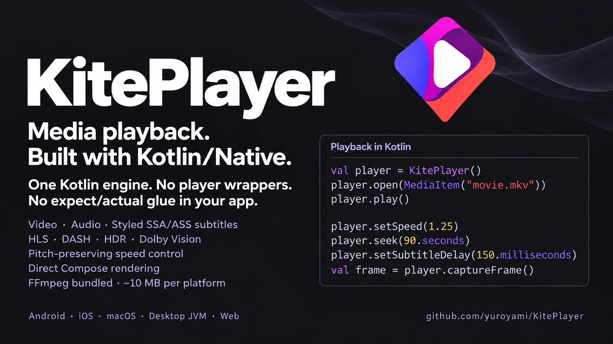

<p align="center">
  
</p>

<p align="center">
  A native media player for Kotlin Multiplatform. Its engine is written in Kotlin and built on FFmpeg.<br>
  It plays the video and audio formats that FFmpeg supports (through KiteFFmpeg) and every common subtitle format (with <code>libass</code> for ASS and SSA).<br>
  It runs on Android, iOS, macOS, the desktop JVM and the web, with one API in <code>commonMain</code>.<br>
  It gives you native video views on Android, iOS and the desktop, and a renderer that draws the video inside Compose for Compose Multiplatform apps.<br>
  It aims to match or beat mpv and VLC in performance and features.
</p>

<p align="center">
  <sub>AI tools helped a great deal in building this project, which would not have been possible
  without them. Its author directed and reviewed all of the work.</sub>
</p>

<p align="center">
  <a href="https://central.sonatype.com/artifact/io.github.yuroyami/kiteplayer"></a>
  <a href="https://github.com/yuroyami/KitePlayer/actions/workflows/ci.yml"></a>
  <a href="https://kotlinlang.org"></a>
  <a href="https://www.jetbrains.com/compose-multiplatform/"></a>
  <a href="LICENSE"></a>
</p>

<p align="center">
  <b><a href="docs/README.md">Guides</a></b>&ensp;·&ensp;<b><a href="https://yuroyami.github.io/KitePlayer/">API reference</a></b>&ensp;·&ensp;<a href="CHANGELOG.md">Changelog</a>
</p>

## Why KitePlayer

A Kotlin Multiplatform player is usually a common API over ExoPlayer on Android and AVPlayer on
Apple. Your app then has two engines that support different files and behave differently.
KitePlayer doesn't wrap any platform player. It is one engine written in Kotlin with
FFmpeg underneath, which is why an MKV file with ASS subtitles plays the same way on a phone, on a
desktop and in a browser.

Since the seeking, the audio and video sync and the subtitle timing are all Kotlin code in
`commonMain`, a platform only has to supply the audio output, the video surface and (where the
device has one) a hardware decoder. Here is what each platform gives you today:

| | Android | iOS | macOS | Desktop JVM | Web |
| --- | :---: | :---: | :---: | :---: | :---: |
| **Hardware decoding** | H.264, HEVC | H.264, HEVC, AV1 | H.264, HEVC, AV1 | On a Mac | |
| **HDR on an HDR screen** | In `KitePlayerView` | ✓ | ✓ | | |
| **HLS and DASH** | ✓ | ✓ | ✓ | ✓ | In a web worker |
| **Video in** | Compose, `View` | Compose, `UIView` | AppKit | Compose, AWT | `<canvas>` |
| **Background playback** | ✓ | ✓ | ✓ | ✓ | While the tab is open |
| **Picture-in-picture** | ✓ | ✓ | ✓ | A floating window | ✓ |

An empty cell means the player falls back to something else: software decoding, or HDR tone mapped
for a standard screen. The engine alone also builds for Linux and Windows native, tvOS and watchOS,
where your app supplies the missing parts ([Platforms](#platforms) lists them).

> [!NOTE]
> KitePlayer has not reached 1.0. It already runs inside a shipping app, but the API can still
> change between versions.

## Install

```kotlin
commonMain.dependencies {
    // Native views, no Compose
    implementation("io.github.yuroyami:kiteplayer:0.3.0")

    // Or Compose, with everything that the line above has
    implementation("io.github.yuroyami:kiteplayer-compose:0.3.0")

    // Optional: a visualizer for media with no picture
    implementation("io.github.yuroyami:kiteplayer-audioviz:0.3.0")
}
```

You don't install FFmpeg (it comes inside the artifacts), and there is no Gradle plugin to apply.
On Android, every artifact needs `minSdk` 26. To build a smaller stack of your own, the
[module contract](docs/module-contract.md) explains what each module brings in.

### What else you need

> [!IMPORTANT]
> Some setups need one more step. If you skip it, the build, the App Store upload or the playback
> fails.

| If you build | You also need |
| --- | --- |
| An iOS app with a static framework (`isStatic = true`) | Linker flags in Xcode ([iOS setup](#ios-setup)) |
| Any iOS app | Two entries in the privacy manifest ([iOS setup](#ios-setup)) |
| A web app (`wasmJs`) | FFmpeg and libass as WebAssembly modules next to the page, plus a third module for the worker player ([Web setup](#web-setup)) |
| An Android app that plays in the background | A service and three permissions in the manifest ([Background playback](#background-playback)) |

<a name="ios-setup"></a>
<details name="setup">
<summary><b>iOS setup</b>: the linker flags and the privacy manifest entries</summary>
<br>

A dynamic framework needs no flags, because Kotlin links it with the system frameworks. Xcode links
a static framework instead, which needs these Other Linker Flags:

```text
-ObjC -lz -framework CoreFoundation -framework CoreMedia -framework CoreVideo -framework VideoToolbox -framework AudioToolbox
```

KitePlayer times playback with `mach_absolute_time`, which Apple lists as a system boot time API.
It also reads file sizes and dates with `stat`, `fstat` and `lstat` (in FFmpeg's file reader, the
libass chain and its own file readers), which Apple lists as file timestamp APIs. App Store Connect
refuses the upload (ITMS-91053) until `PrivacyInfo.xcprivacy` declares both. Keep only the reasons
that apply to your app: `35F9.1` is time measured between events inside the app, `C617.1` is files
inside the app container, and `3B52.1` is files that the user picked.

```xml
<key>NSPrivacyAccessedAPITypes</key>
<array>
    <dict>
        <key>NSPrivacyAccessedAPIType</key>
        <string>NSPrivacyAccessedAPICategorySystemBootTime</string>
        <key>NSPrivacyAccessedAPITypeReasons</key>
        <array><string>35F9.1</string></array>
    </dict>
    <dict>
        <key>NSPrivacyAccessedAPIType</key>
        <string>NSPrivacyAccessedAPICategoryFileTimestamp</string>
        <key>NSPrivacyAccessedAPITypeReasons</key>
        <array><string>C617.1</string><string>3B52.1</string></array>
    </dict>
</array>
```

</details>

<a name="web-setup"></a>
<details name="setup">
<summary><b>Web setup</b>: the modules that a page serves</summary>
<br>

A browser cannot link FFmpeg or libass into the Kotlin binary, so the page serves them as separate
WebAssembly modules. Each one is published as a `web` zip next to its artifact on Maven Central:

1. Unpack `kiteffmpeg-wasm-js-<version>-web.zip` next to `index.html`. Use the KiteFFmpeg version
   that KitePlayer depends on (0.5.1 for KitePlayer 0.3.0).
2. Unpack `kiteplayer-libass-wasm-js-<version>-web.zip` next to it. Without this module, KitePlayer
   draws ASS subtitles with its built-in styling.
3. Call `KiteFFmpegWeb.load()` before you create a player. Under a bundler, instantiate the module
   from a plain `<script type="module">` and pass it to `KiteFFmpegWeb.attach()` instead.

Serve `.mjs` as `text/javascript` and `.wasm` as `application/wasm`. Both modules are
single-threaded, so the page needs no cross-origin isolation headers. A browser starts audio only
after the user interacts with the page, and the position stays at zero until then.

A player on the page's main thread cannot play network media, because it cannot block while it
waits for a read. It can still play bytes that the page has already fetched. For network media,
`KitePlayerWorker.start(canvas)` runs the player in a web worker. The worker plays `http`, `https`
and `blob` addresses, including HLS and DASH, and draws on your canvas while the main thread stays
free. It needs a third module from `kiteplayer-wasm-js-<version>-web.zip`, which also goes next to
`index.html`. The worker has the same calls and flows as `KitePlayer`, except for a few that its
KDoc lists, such as recording. It takes an address, not an item with its own reader.

</details>

## Usage

### Play a video in Compose

`rememberKitePlayer()` creates a player that closes when the composable leaves the composition.
`KitePlayerVideo` shows its video, here with the default controls on top:

```kotlin
import androidx.compose.foundation.layout.fillMaxSize
import androidx.compose.runtime.Composable
import androidx.compose.runtime.LaunchedEffect
import androidx.compose.ui.Modifier
import io.github.yuroyami.kiteplayer.MediaItem
import io.github.yuroyami.kiteplayer.compose.KitePlayerControls
import io.github.yuroyami.kiteplayer.compose.KitePlayerVideo
import io.github.yuroyami.kiteplayer.compose.rememberKitePlayer

@Composable
fun MovieScreen() {
    val player = rememberKitePlayer()

    KitePlayerVideo(player, Modifier.fillMaxSize()) {
        // Play, pause, seek, volume, tracks and speed
        KitePlayerControls(player)
    }

    LaunchedEffect(player) {
        // Returns once the movie is open
        player.open(MediaItem("https://example.com/movie.mkv"))
        player.play()
    }
}
```

By default, `KitePlayerVideo` hosts the platform's own video view. The system compositor then shows
the frames, and the GPU stays idle during long playback. Pass `path = KiteRenderPath.ComposeCanvas`
when the video has to clip, fade or take part in a shared element transition. That path draws the
frames inside Compose. You can switch paths while the video plays.

> [!WARNING]
> On the desktop JVM, the native view takes every click. Controls that you draw over it do not
> receive clicks. Use `KiteRenderPath.ComposeCanvas` there, or put the controls beside the video.

On Android, a rotation recreates the activity, which closes a player that `rememberKitePlayer()`
holds. To keep playing through a rotation, keep the player in a `ViewModel` instead, and close it
in `onCleared`.

The building blocks of `KitePlayerControls` are public too. You can build your own controls from
the same state holders, such as `rememberSeekBarState` and `rememberTrackMenuState`. The default
controls are in English unless you pass your own `KitePlayerControlsLabels`.

### Without Compose

Each platform has a native view that takes the player: `KitePlayerView` on Android (from XML or
code), `KitePlayerUIView` on iOS and `KitePlayerAwtView` on the desktop JVM, all in
`io.github.yuroyami.kiteplayer.view`. A view can also draw default controls with its own toolkit:

```kotlin
view.player = player
view.showsControls = true
```

A native macOS app draws into an `AppKitWindow` through `MetalVideoRenderer` instead. The macOS
sample in `kiteplayer-sample` shows the setup. A web page without Compose draws on a `<canvas>`, as
the [web setup](#web-setup) describes.

<details>
<summary><b>From Java</b></summary>
<br>

On Android and the desktop JVM, `KitePlayerJava` wraps the player for Java code. Listeners run on
an executor that you choose, every suspending call returns a `CompletableFuture`, and times are in
milliseconds where Kotlin takes a `Duration`:

```java
KitePlayerJava player = KitePlayerJava.create();
player.addListener(new KitePlayerListener() {
    @Override
    public void onState(PlayerSnapshot state) {
        statusView.setText(state.getStatus().name());
    }

    @Override
    public void onProgress(Progress progress) {
        seekBar.setProgress((int) progress.getPositionMillis());
    }
}, ContextCompat.getMainExecutor(context));

player.openAsync(new MediaItemBuilder("https://example.com/movie.mkv").build())
        .thenRun(() -> player.getPlayer().play());
player.seekAsync(90_000);

// When the screen goes away:
player.close();
```

Canceling a future cancels its call. The other calls, such as `play()`, `pause()` and
`setVolume(float)`, are on `getPlayer()`. A listener only receives the events that happen after you
add it.

</details>

### Control it and read its state

Calls such as `open`, `seek` and `selectTrack` suspend until they are done, while `play`, `pause`
and the setters return at once:

```kotlin
import io.github.yuroyami.kiteplayer.TrackKind
import kotlin.time.Duration.Companion.seconds

player.seek(90.seconds)
player.setSpeed(1.5)
player.setVolume(0.8f)

// Every audio, video and subtitle track of the open item
val tracks = player.state.value.tracks
val french = tracks.audio.first { it.language == "fr" }
player.selectTrack(TrackKind.Audio, french.id)
```

Collect `player.state` for the status, the tracks and every setting, and `player.progress` for the
position and the buffer. `player.events` reports what happens, including warnings and errors. When
the player cannot do what a call asks, the call fails with a typed error. It is never silently
ignored.

The player can also:

- play a gapless queue, or crossfade between songs, with shuffle and loop
- apply a ten-band equalizer and ReplayGain
- follow an external clock, for watching together
- step frame by frame and take screenshots
- record what plays into a Matroska file, without re-encoding
- play Matroska editions, including ordered chapters that take a season's opening and ending from
  other files ([Editions and linked files](docs/media-sources.md#editions-and-linked-files))
- show a 360 degree video as a view that your app turns with a drag or with the phone's motion
  ([360 degree video](docs/spherical-video.md))

[Controlling the player](docs/player-api.md) lists every call by area.

### Open local and picked files

A file path or a URL goes straight to FFmpeg. So does the `Res.getUri` address of a Compose
resource on Android, iOS and the desktop JVM. Anything else reaches the player through a `MediaIo`.
This is how an Android app plays a file that the user picked:

```kotlin
import io.github.yuroyami.kiteplayer.MediaIo
import io.github.yuroyami.kiteplayer.MediaItem
import io.github.yuroyami.kiteplayer.from
import io.github.yuroyami.kiteplayer.io.ofUri

val io = MediaIo.ofUri(contentResolver, uri)
player.open(MediaItem.from(io, label = "picked.mkv"))
```

`MediaIo` can also read a `ByteArray`, a `File`, an `InputStream`, an Android asset or an Apple
file URL. [Opening media](docs/media-sources.md) lists each one and the platforms it works on. The
same guide covers request headers, files that are still being written, and a separate audio file
that plays with a video, such as a dub.

### Subtitles

KitePlayer reads these subtitle formats:

- ASS and SSA, drawn by libass exactly as authored, including signs and karaoke
- SubRip, WebVTT and TTML
- image subtitles from Blu-ray, DVD and DVB, and DVB teletext
- closed captions inside broadcast video
- synced lyrics

Each subtitle is a track of the item. A subtitle file that you add during playback becomes a track
too:

```kotlin
import io.github.yuroyami.kiteplayer.SubtitleSource
import io.github.yuroyami.kiteplayer.TrackKind

val id = player.addExternalSubtitle(
    SubtitleSource("https://example.com/movie.en.srt"),
)
player.selectTrack(TrackKind.Subtitle, id)
```

A second subtitle track can show at the same time as the first. Delay, scale, position and style
each have their own call. A safe area keeps the text clear of a camera cutout or your controls.
[Subtitles](docs/subtitles.md) covers the rest, from hearing-impaired notes to forced tracks and
fonts.

### Streams

HTTP, HTTPS, HLS and DASH URLs play directly, because every standard entry point includes
`kiteplayer-network` (OkHttp on Android and the JVM, NSURLSession on Apple). An adaptive stream
picks the quality that fits the screen. It steps down when the network slows, steps back up when
the network recovers, and only downloads the audio language that you are listening to. A radio
station's PLS or M3U link also plays directly, and shows each song's title as the station
announces it.

By default, every open downloads the segments of an HLS or DASH stream again. A segment store keeps
them on disk for the next time:

```kotlin
import io.github.yuroyami.kiteplayer.KitePlayer
import io.github.yuroyami.kiteplayer.NetworkConfig
import io.github.yuroyami.kiteplayer.PlayerConfig
import io.github.yuroyami.kiteplayer.network.fileSegmentStore

val store = fileSegmentStore(
    "$cacheDirectory/kite-segments",
    maxBytes = 512L * 1024 * 1024,
)
val player = KitePlayer(
    PlayerConfig(network = NetworkConfig(segmentStore = store)),
)
```

[Segment store](docs/segment-cache.md) explains what the store keeps, and
[Network streams](docs/streaming.md) covers headers, live streams, DASH Periods, radio and recovery
after a network drop. In a browser, network media plays through the worker player that the
[web setup](#web-setup) describes.

### Background playback

Android can stop an app that plays in the background, unless a foreground service keeps it
running. KitePlayer ships that service, `KitePlayerMediaService`. Declare it in your manifest
together with its permissions:

```xml
<uses-permission android:name="android.permission.FOREGROUND_SERVICE" />
<uses-permission android:name="android.permission.FOREGROUND_SERVICE_MEDIA_PLAYBACK" />
<uses-permission android:name="android.permission.WAKE_LOCK" />

<application>
    <service
        android:name="io.github.yuroyami.kiteplayer.session.KitePlayerMediaService"
        android:exported="false"
        android:foregroundServiceType="mediaPlayback" />
</application>
```

Then attach a media session with notification options. The session shows the media notification
and keeps the app playing in the background. It also takes audio focus, and it closes with the
player:

```kotlin
import io.github.yuroyami.kiteplayer.session.MediaNotificationOptions
import io.github.yuroyami.kiteplayer.session.attachMediaSession

// smallIcon is your monochrome notification icon
val options = MediaNotificationOptions(smallIcon = R.drawable.ic_notification)
player.attachMediaSession(context, options)
```

On iOS, add `audio` to `UIBackgroundModes` in `Info.plist`, then call
`player.attachMediaSession()` for the lock screen. A native Mac app calls it too, to show the
player in Now Playing and connect it to the media keys. [Background playback](docs/background-playback.md)
covers the notification's buttons, artwork, wake locks and timeouts.

<a name="audio-visualiser"></a>
### Music and the visualizer

`kiteplayer-audioviz` draws a visualizer for media without video. `isAudioOnly` tells you when to
show it instead of the video. A song with cover art counts as audio only:

```kotlin
import androidx.compose.foundation.layout.fillMaxSize
import androidx.compose.runtime.Composable
import androidx.compose.runtime.collectAsState
import androidx.compose.runtime.getValue
import androidx.compose.ui.Modifier
import io.github.yuroyami.kiteplayer.KitePlayer
import io.github.yuroyami.kiteplayer.audioviz.KiteAudioViz
import io.github.yuroyami.kiteplayer.audioviz.isAudioOnly
import io.github.yuroyami.kiteplayer.audioviz.rememberAudioVizState
import io.github.yuroyami.kiteplayer.compose.KitePlayerVideo

@Composable
fun NowPlaying(player: KitePlayer) {
    val viz = rememberAudioVizState(player)
    val snapshot by player.state.collectAsState()

    if (snapshot.isAudioOnly) {
        KiteAudioViz(viz, Modifier.fillMaxSize())
    } else {
        KitePlayerVideo(player, Modifier.fillMaxSize())
    }
}
```

Create the state next to the player, not inside the audio-only branch, so that it listens from the
first note of a song. `viz.drawing` and `viz.palette` choose what it draws, and
`viz.directed = true` lets the drawing change with the music. `AudioVizBrowser` shows every drawing
in a live grid.

<a name="modules"></a>
## Platforms

| | `kiteplayer` | `kiteplayer-compose` | `kiteplayer-audioviz` |
| --- | :---: | :---: | :---: |
| **Android** | ✓ | ✓ | ✓ |
| **iOS** | ✓ | ✓ | ✓ |
| **Desktop JVM** | ✓ | ✓ | ✓ |
| **macOS** (native) | ✓ | | |
| **Web** (`wasmJs`) | ✓ | ✓ | |
| **Linux and Windows** (native) | No audio output | | |

- On iOS, the artifacts target `iosArm64` and `iosSimulatorArm64`, with no `iosX64`.
- The desktop JVM build carries FFmpeg and libass for macOS on Apple silicon, Linux (x64 and
  arm64) and Windows (x64). It runs on Java 11 or later.
- On Linux and Windows native, KitePlayer has no audio output and no HTTPS. `KitePlayer()` throws
  there, and `KitePlayer.isAvailable` is false. Pass `KiteFFmpegMediaBackend()` and your own
  `OutputBackend` to `KitePlayer.create`.
- On the web, `kiteplayer-compose` draws the video inside Compose's own WebGL context, so it needs
  a browser with WebGL2. Clipping, alpha and other Compose content apply to it as on the other
  platforms. It runs the player on the page's main thread. The worker player draws on a canvas of
  its own.
- `kiteplayer` also compiles for `js`, where `KitePlayer()` reports that the target is not
  available.
- The engine modules (`kiteplayer-core`, `kiteplayer-io` and `kiteplayer-subtitles`) also build
  for tvOS, watchOS and Android Native.

## App size and licensing

KitePlayer puts FFmpeg and libass into your app as native code:

- On Android, they add about 22 MB per ABI before compression (18.8 MB for FFmpeg and 3.4 MB for
  libass, measured on `arm64-v8a`).
- On the desktop JVM, the KiteFFmpeg jar is about 39 MB, because it carries FFmpeg for four
  desktop platforms. The libass jar adds about 6 MB.
- On the web, the page downloads about 1.5 MB for the codec module and 0.7 MB for the worker
  player, with gzip.

KitePlayer itself is Apache-2.0. Three of the libraries that the artifacts link statically use the
LGPL: FFmpeg and FriBidi (LGPL-2.1-or-later), and GNU libiconv in the Windows JVM build of
`kiteplayer-libass` (LGPL-2.0-or-later). An app that ships them has three duties:

| Duty | How to meet it |
| --- | --- |
| Say that the app uses them, under the LGPL | Ship a notice with the license texts. The JVM and Android artifacts carry the texts under `META-INF/licenses/`. For a native app, take the texts from the sources listed in [NOTICE](NOTICE). |
| Make their source available to your users | Point to the source listed in KiteFFmpeg's `NOTICE` and in this repository's [NOTICE](NOTICE). |
| Let users relink against a modified copy | Publish your object files, or give a written offer for them. |

The other components (dav1d, libass, HarfBuzz and FreeType) use permissive licenses that only ask
for their notices, which [NOTICE](NOTICE) lists. KiteFFmpeg's
[licensing guide](https://yuroyami.github.io/KiteFFmpeg/licensing/) explains the static linking
case in detail.

<a name="limits"></a>
## A few limitations to know about

- KitePlayer does not play media protected by DRM (digital rights management). It skips encrypted
  DASH adaptation sets. When every audio and video set of a DASH manifest is encrypted, it refuses
  the manifest with `DashUnsupportedException`.
- The web build has no software AV1 decoder. The AV1 decoder (dav1d) needs threads, and the web
  build runs on one thread.
- KitePlayer converts Dolby Vision profile 5 and 10.0 to HDR10 on the CPU. That keeps up at 1080p,
  but not at 4K.
- Nobody has played sound with the desktop JVM build on a real Linux or Windows computer yet.
- You can only look around in a 360 degree video where `KiteVideo` draws it. The native views that
  `KitePlayerVideo` uses by default on Android, iOS and the desktop JVM show the whole frame flat,
  so pass `path = KiteRenderPath.ComposeCanvas` there. On Android, the 360 degree view needs
  Android 13 or later.

Missing features and known bugs are [open issues](https://github.com/yuroyami/KitePlayer/issues).

## Sample apps

The desktop, Android and iOS sample apps open on the audio visualizer with five songs by Skullbeatz
(under CC BY-SA 3.0, credited in [the media folder](kiteplayer-sample-shared/media/README.md)):

```bash
./gradlew :kiteplayer-sample-desktop:run
```

```bash
./gradlew :kiteplayer-sample-android:installDebug
```

For iOS, open `kiteplayer-sample/iosApp/KitePlayerSample.xcodeproj`, which builds the Kotlin
framework itself. The same module also builds a native macOS app: run
`./gradlew :kiteplayer-sample:linkDebugExecutableMacosArm64`, then start `kiteplayer.kexe` with a
media file and `--window`. `kiteplayer-sample-web` plays a clip through `KiteVideo` on a Compose
web page. Open it with `?probe` to measure what a frame costs there.

To work on KitePlayer itself, start with [CONTRIBUTING.md](CONTRIBUTING.md).

## License

Apache-2.0. [NOTICE](NOTICE) lists each third-party component with its license.

Part of the Kite family: [KiteFFmpeg](https://github.com/yuroyami/KiteFFmpeg),
[Kite3D](https://github.com/yuroyami/Kite3D),
[KitePDF](https://github.com/yuroyami/KitePDF).
